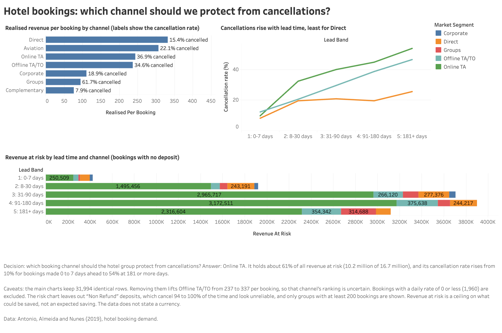
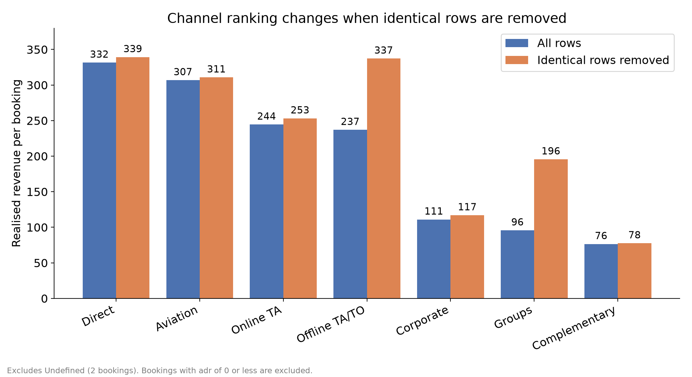
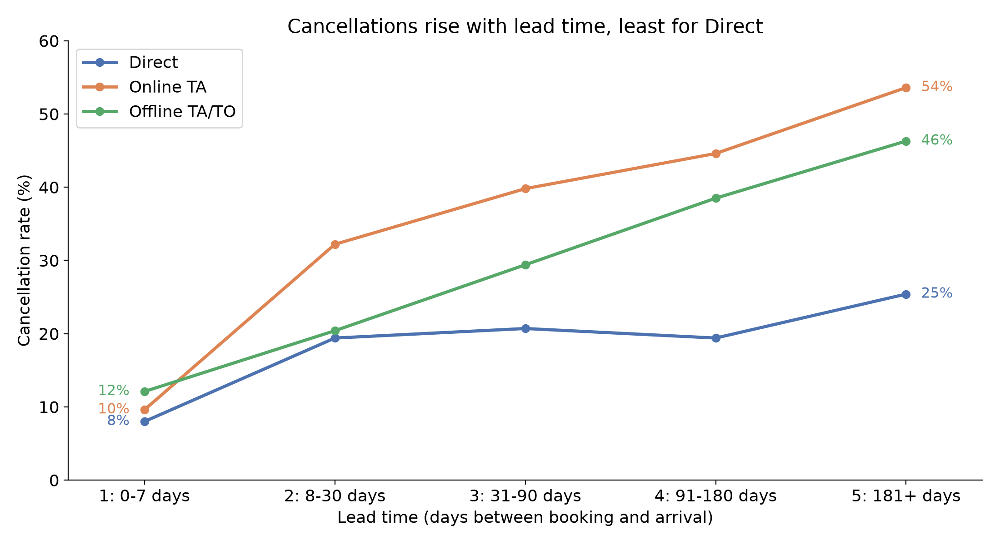
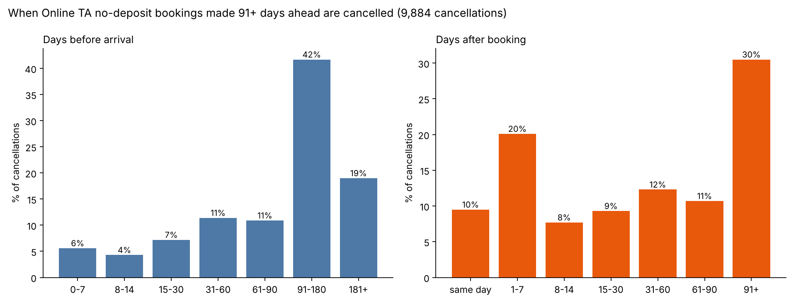
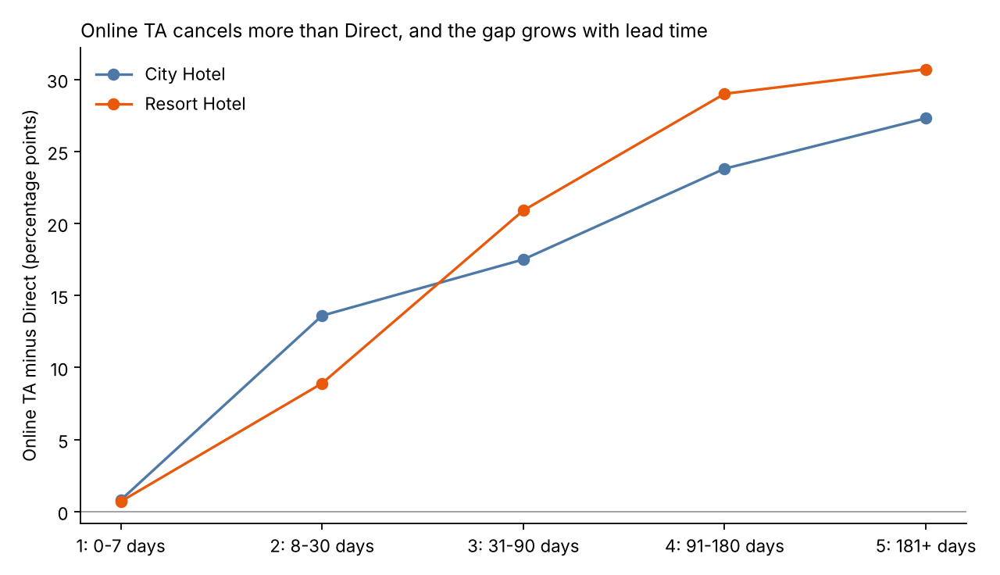

# Hotel bookings: which channel should we protect from cancellations?

A portfolio project in SQL, Python and Tableau. It uses two years of hotel booking records to answer one business question: which booking channel loses the most revenue to cancellations, and what should a hotel group test first to reduce it?

**Answer:** Online TA (online travel agents). It holds about 61% of all revenue at risk from cancellations (10.2 million of 16.7 million) on 48% of bookings. The recommended next step is a randomised test of early reminders (about 3 and 30 days after booking) on Online TA bookings with no deposit that were made 91 or more days ahead (20,673 bookings, 5.5 million at risk). The full reasoning is in [memo/memo.md](memo/memo.md).

[Live dashboard on Tableau Public](https://public.tableau.com/views/Hotelbookingchannelquality/Dashboard1)



## Key findings

All figures are room revenue (daily rate times nights). The data does not state a currency.

| Channel | Bookings | Cancelled (%) | Realised revenue per booking | Revenue at risk | Realised per booking, identical rows removed |
| --- | --- | --- | --- | --- | --- |
| Direct | 12,366 | 15.4 | 331.5 | 993,410 | 339.2 |
| Aviation (too small to rely on) | 231 | 22.1 | 306.8 | 16,578 | 310.7 |
| Online TA | 56,110 | 36.9 | 244.4 | 10,227,646 | 253.1 |
| Offline TA/TO | 23,887 | 34.6 | 236.9 | 2,492,358 | 337.2 |
| Corporate | 5,213 | 18.9 | 110.9 | 196,383 | 116.9 |
| Groups | 19,558 | 61.7 | 95.6 | 2,800,544 | 195.5 |
| Complementary (too small to rely on) | 63 | 7.9 | 76.4 | 270 | 77.5 |

- **Cancellations rise with lead time.** For Online TA the rate goes from 9.6% at 0 to 7 days to 53.6% at 181 or more days. Direct stays between 8.0% and 25.4%.
- **Online TA still cancels more than Direct like for like.** With Direct's mix of hotel and lead time, Online TA would cancel 27.2% of bookings against Direct's 15.4%. For bookings made 0 to 7 days ahead the gap is under one point; for 181 or more days ahead it is 27.3 points (City Hotel) and 30.7 points (Resort Hotel).
- **Cancellations are early.** In the test group the median cancellation is 107 days before arrival and 40 days after booking. 83% are at least 30 days before arrival and about 30% are within a week of booking, so a reminder just before arrival would reach about 10% of them.
- **The ranking depends on an unresolved data question.** The file has 31,994 identical rows and no booking ID, so they may be copies or real bookings. Without them Groups cancellation falls from 61.7% to 27.9% and Offline TA/TO rises from 236.9 to 337.2 per booking. Online TA barely moves (36.9% to 35.6%).
- **The hotel matters.** Offline TA/TO earns 421.0 per booking at the Resort Hotel and 154.7 at the City Hotel.
- **Rankings depend on hotel and lead time.** Within a hotel and lead-time band, Direct ranks first everywhere except bookings made 0 to 7 days ahead, where Online TA is first in both hotels (`sql/03_q4_ranking_within_groups.csv`).
- **Non Refund deposits look unreliable.** They cancel 94 to 100% of the time in every group of 200 or more bookings, so they are left out of the risk analysis.

## Charts

Removing the identical rows changes the ranking of Groups and Offline TA/TO, and cancellations climb with lead time:





Most cancellations in the test group happen early, and the gap between Online TA and Direct opens up with lead time:





## What I did

| Step | What | Files |
| --- | --- | --- |
| 1. Profile | Size, period, ranges, missing values, odd rows, duplicates, and a leakage check on `reservation_status` | [python/00_profile.py](python/00_profile.py) |
| 2. Load and check | Load the CSV into MySQL, keep an untouched backup, test the identical rows, define the measures once in a view | [python/01_load.py](python/01_load.py), [sql/02_checks_and_cleaning.sql](sql/02_checks_and_cleaning.sql) |
| 3. SQL analysis | Channel quality overall, by hotel, by lead time and by month, a ranking inside each hotel and lead-time band, the effect of each cleaning choice, and a commission sensitivity | [sql/03_channel_quality.sql](sql/03_channel_quality.sql), [sql/03_results_notes.md](sql/03_results_notes.md) |
| 4. Python | Automated data checks on the CSV and on the database; the SQL results rebuilt in pandas and compared; a simple risk grouping; charts | [python/checks.py](python/checks.py), [python/checks_db.py](python/checks_db.py), [python/04_pandas_channel_analysis.py](python/04_pandas_channel_analysis.py) |
| 4b. Timing and like-for-like | When cancellations happen, Online TA against Direct at the same hotel and lead time, intervals, break-even and sample size | [python/06_timing_and_adjusted.py](python/06_timing_and_adjusted.py), [memo/06_results_notes.md](memo/06_results_notes.md) |
| 5. Dashboard | Three charts and a caveats note in Tableau Public | [results/05_dashboard.png](results/05_dashboard.png) |
| 6 and 7. Memo and test design | The recommendation, the evidence, the limits, and a design for a reminder test with sample size and cost break-even | [memo/memo.md](memo/memo.md), [memo/decision_log.md](memo/decision_log.md) |

## Repository structure

```
hotel-booking-channel-quality/
  README.md
  AI_LOG.md                  how AI was used and what was checked
  requirements.txt
  .env.example               template for your MySQL details (the real .env is not in the repo)
  .gitignore
  data/                      the CSV is not in the repo, see "Data" below
    README.md
  python/
    db.py                    shared database connection
    00_profile.py
    01_load.py
    checks.py                checks on the CSV
    checks_db.py             checks on the database and the view
    run_sql_exports.py       runs the SQL file and writes the exported CSVs
    04_pandas_channel_analysis.py
    06_timing_and_adjusted.py
  sql/
    02_checks_and_cleaning.sql
    03_channel_quality.sql
    03_results_notes.md
    03_q*.csv                result tables from MySQL (written by run_sql_exports.py)
  tableau/
    README.md                link to the live dashboard
    hotel_booking_channel_quality.twbx   workbook exported from Tableau Public
  results/
    04_*.csv                 result tables from pandas
    04_chart_*.png           charts from pandas
    05_dashboard.png
    06_*.csv                 timing, like-for-like, intervals, break-even
    06_chart_*.png
  memo/
    memo.md
    decision_log.md
    06_results_notes.md
```

## How to reproduce

You need Python 3, MySQL, and a SQL client such as DBeaver.

1. Create a virtual environment and install the packages:

   ```
   python -m venv .venv
   source .venv/bin/activate
   pip install -r requirements.txt
   ```

2. Download the data (see "Data") and save it as `data/hotel_bookings.csv`.
3. In MySQL, create an empty database: `CREATE DATABASE hotel_bookings;`
4. Copy `.env.example` to `.env` in the project folder and fill in your own MySQL details. `.env` is excluded from Git.

   ```
   MYSQL_USER=your_user
   MYSQL_PASSWORD=your_password
   MYSQL_HOST=localhost
   ```

5. Run the scripts and queries in this order:

   ```
   python python/00_profile.py
   python python/01_load.py
   ```

   Then run `sql/02_checks_and_cleaning.sql` in your SQL client (DBeaver). Then:

   ```
   python python/checks.py
   python python/checks_db.py
   python python/run_sql_exports.py
   python python/04_pandas_channel_analysis.py
   python python/06_timing_and_adjusted.py
   ```

   `run_sql_exports.py` runs `sql/03_channel_quality.sql` and writes the nine result files, so nothing is exported by hand. `04_pandas_channel_analysis.py` compares its tables with those files and prints MATCH or DIFFERENT. A rounded revenue figure can differ by 1 between database versions.

## Data

Antonio, N., Almeida, A. and Nunes, L. (2019). Hotel booking demand datasets. *Data in Brief*, 22, 41-49. DOI: [10.1016/j.dib.2018.11.126](https://doi.org/10.1016/j.dib.2018.11.126).

The same data is in the TidyTuesday repository as `hotels.csv` ([download](https://raw.githubusercontent.com/rfordatascience/tidytuesday/main/data/2020/2020-02-11/hotels.csv)), and on Kaggle as `hotel_bookings.csv`. It holds 119,390 bookings from two hotels (one city hotel, one resort hotel) with arrivals from July 2015 to August 2017, one row per booking and 32 columns.

The paper's record states no licence, so the data file is not included in this repository. Download it from the source above and cite the paper.

## Limits

The data shows which bookings were cancelled and, from the status date, roughly when. It does not show why, and not what would have prevented it. There is no booking ID, so a guest who cancels and rebooks cannot be seen. There are no costs, commissions, cancellation fees or resale information, so revenue at risk is a ceiling on what could be saved, not an expected saving. The commission rates in the sensitivity table are assumptions. The memo lists the full limits and the questions I would ask the business.

## Tools

MySQL, DBeaver, Python (pandas, SQLAlchemy, PyMySQL, python-dotenv, matplotlib), Tableau Public.

## Use of AI

I used an AI assistant to draft code, SQL and the first version of the memo. I ran everything myself, compared results across two tools, and corrected errors. [AI_LOG.md](AI_LOG.md) records what was done, what was checked, and the mistakes found along the way.

## Author

Serena Cheng. [LinkedIn](https://www.linkedin.com/in/serenacheng95)
